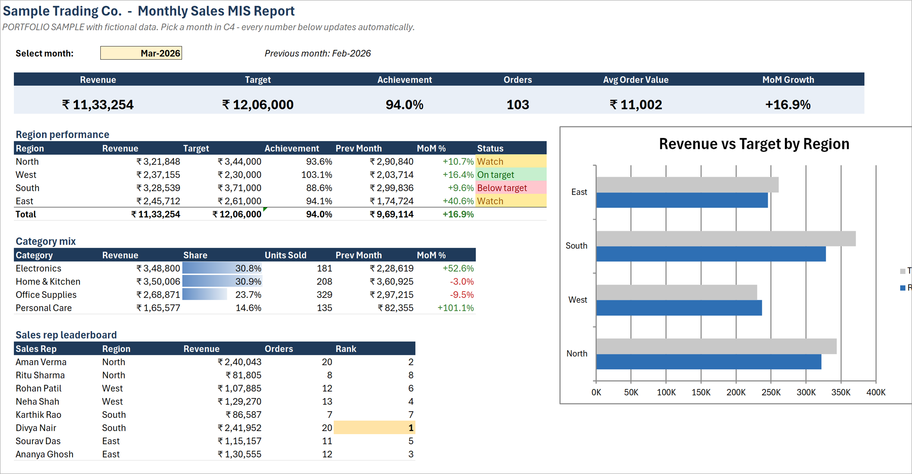
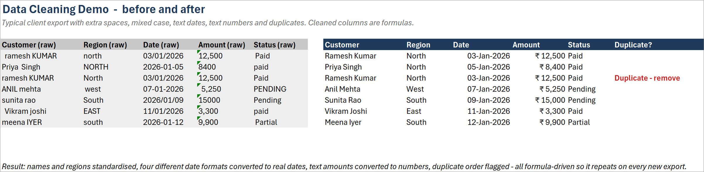
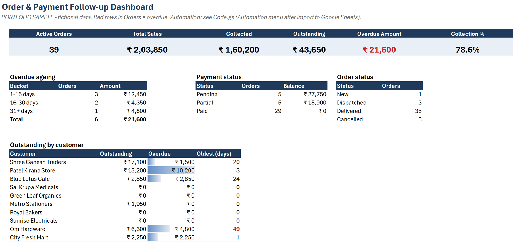
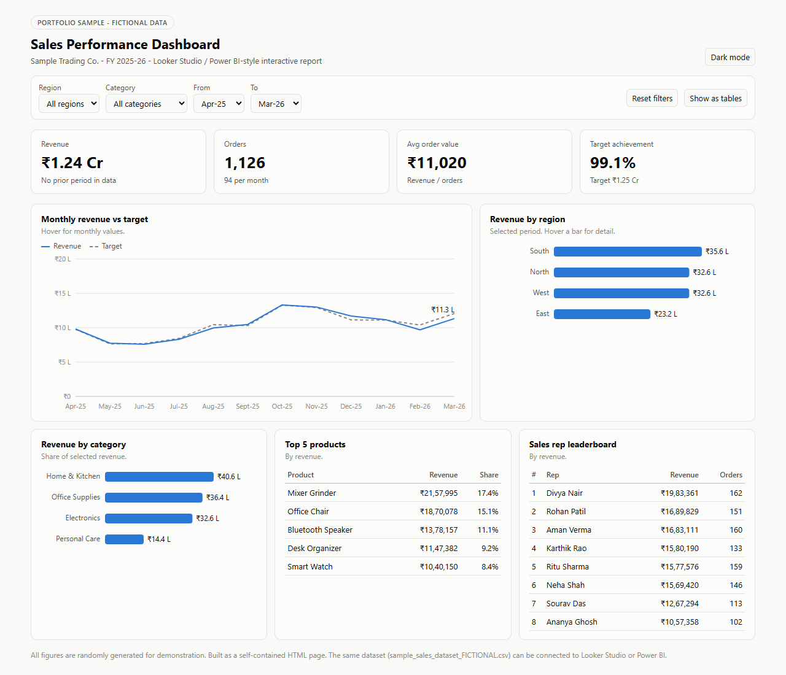
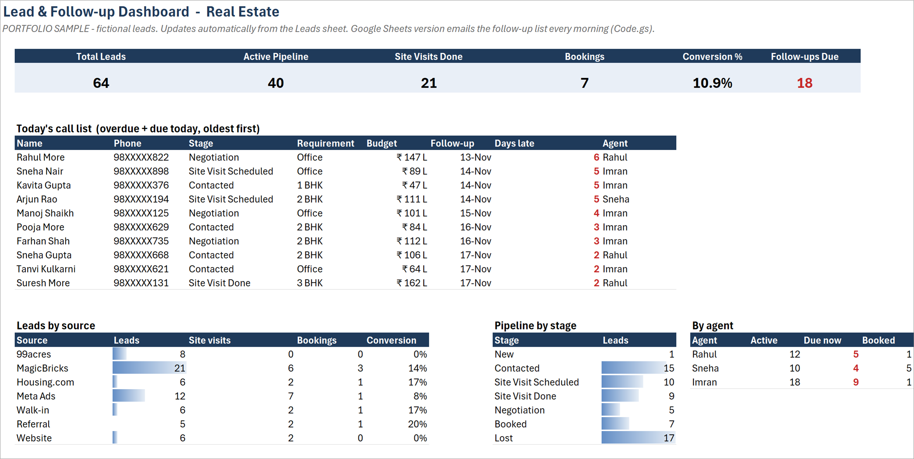

# Excel · Google Sheets · MIS Reporting · Dashboards · Automation

A portfolio of reporting and automation samples. **All data in this repository is fictional** and was generated for demonstration.

| # | Sample | Tools | Highlights |
|---|---|---|---|
| 01 | [Monthly Sales MIS Report](Sample_01_Excel_MIS_Report) | Excel | Month picker, KPI cards, region / category / sales-rep breakdowns, target vs actual, MoM %, status flags, 12-month trend chart, formula-based data-cleaning demo |
| 02 | [Order & Payment Follow-up Tracker](Sample_02_Google_Sheets_Automation) | Google Sheets, Apps Script | Live balances, overdue ageing, customer outstanding, auto timestamps, daily overdue email, one-click monthly summary |
| 03 | [Interactive Sales Dashboard](Sample_03_Interactive_Dashboard) | HTML / SVG (Looker Studio / Power BI style) | Filters, KPI tiles, revenue vs target trend, region & category bars, top products, rep leaderboard, light / dark mode |
| 04 | [Real Estate Lead & Follow-up Tracker](Sample_04_Real_Estate_Lead_Tracker) | Google Sheets, Apps Script | Lead register, overdue / due-today highlighting, today's call list, conversion by source, pipeline by stage, 9 AM call-list email |

Dataset used by samples 01 and 03: [`sample_sales_dataset_FICTIONAL.csv`](sample_sales_dataset_FICTIONAL.csv) (1,126 fictional orders, Apr-2025 to Mar-2026).

## Previews
**01 · Monthly Sales MIS Report**

**01 · Data cleaning demo**

**02 · Order & Payment Follow-up Tracker**

**03 · Interactive Sales Dashboard** (download the HTML file and open it in a browser)

**04 · Real Estate Lead & Follow-up Tracker**

## Using the Google Sheets samples
Upload the `.xlsx` to Google Drive and open it with Google Sheets, then go to **Extensions → Apps Script**, paste in the sample's `Code.gs`, save, and reload. A custom menu appears; the daily email is switched on from that menu.
