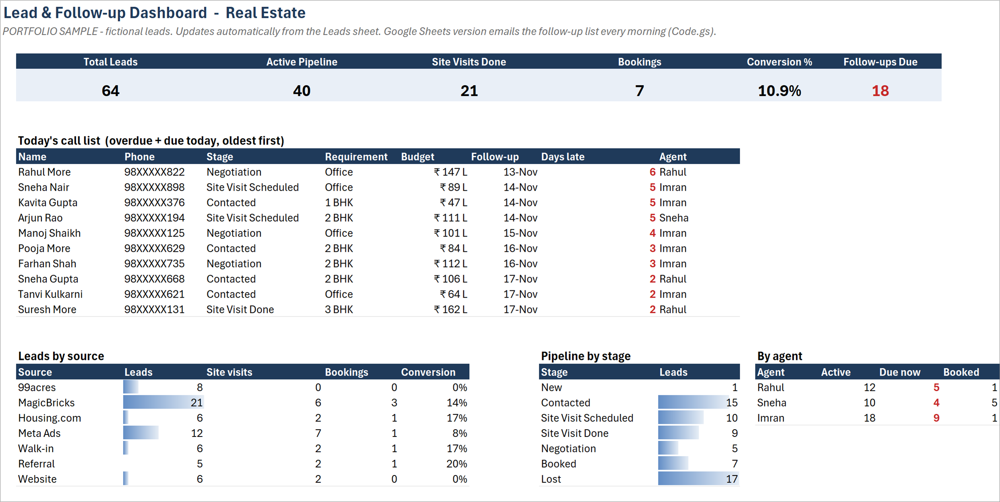
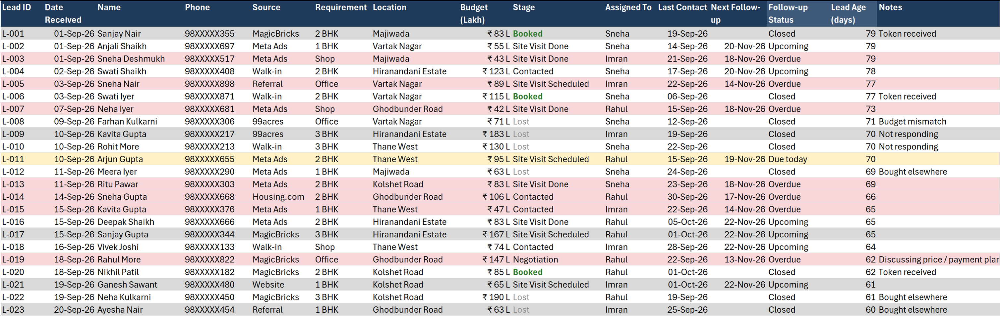

# Sample 04: Real Estate Lead & Follow-up Tracker
**Portfolio sample. All leads, names and phone numbers are fictional.**

A Google Sheets / Excel tracker for small real-estate agencies and builders, so no lead slips through the cracks.

## What's inside
| Sheet | What it does |
|---|---|
| **Leads** | One row per lead: source, requirement, location, budget, stage, agent, last contact, next follow-up. Dropdowns keep entries clean. Rows turn **red when a follow-up is overdue** and **yellow when it's due today**. |
| **Dashboard** | KPIs (total leads, active pipeline, site visits, bookings, conversion %, follow-ups due), **today's call list** (overdue first), leads and conversion **by source**, pipeline **by stage**, and workload **by agent**. Everything updates automatically. |
| **Code.gs** (Google Sheets) | Emails the call list every morning at 9 AM (optionally one list per agent), auto-fills the Lead ID and date for new leads, and stamps "Last Contact" when a stage changes. |

## Typical customisation
Your own lead sources (portals, Meta ads, walk-ins), projects/locations, team members and stages; WhatsApp click-to-chat links; a monthly management report; import from portal CSV exports.
